<!-- datasheet:banner -->
<p align="center">
  <picture>
    <source media="(prefers-color-scheme: dark)" srcset=".github/assets/banner-dark.svg">
    
  </picture>
</p>
<!-- /datasheet:banner -->

# Music Visualiser

**Two visualisers, one signal path: a terminal app that paints your album art and spectrum while a song plays, and an ESP32 that shows the same idea on a tiny OLED.**

- **[`macos/`](macos/)** is a terminal app for macOS. It decodes local audio files, reads full media tags and embedded artwork, and renders a real-time HD ASCII/pixel visualisation (half-block true-colour album art, braille waveform, FFT spectrum bars) in step with playback.
- **[`esp32/`](esp32/)** is ESP32 + SSD1306 OLED firmware that pairs as a Bluetooth A2DP sink and shows a live spectrum plus the scrolling track title and artist on the small screen.

<!-- datasheet:figure -->
## At a glance

<p align="center">
  <picture>
    <source media="(prefers-color-scheme: dark)" srcset=".github/assets/diagram-dark.svg">
    
  </picture>
</p>

| Characteristic | Detail |
| --- | --- |
| **Terminal app** | Real-time HD ASCII/pixel render: true-colour half-block album art, eighth-block FFT bars, braille oscilloscope |
| **Tags** | Title, artist, album, year, genre and embedded cover art from mp3, m4a/mp4/aac, flac, wav, aiff, ogg, opus, wma |
| **Lyrics** | Synced `.lrc` with karaoke-style highlighting, including stacked original / romanization / translation layers |
| **ESP32 build** | Pairs as a Bluetooth A2DP sink and shows a live spectrum plus scrolling track title on an SSD1306 OLED |
| **CI** | Lints and tests the macOS app and compiles the ESP32 firmware on every push |
<!-- /datasheet:figure -->

## Quick start

```bash
git clone https://github.com/S-k404/music-visualiser.git
brew install ffmpeg                                  # decodes mp3, m4a, aac, wma and opus
cd music-visualiser/macos && ./run.sh "/path/to/song-or-folder"   # first run creates macos/.venv
```

## Features

- Real-time HD ASCII/pixel rendering: true-colour half-block album art, eighth-block FFT spectrum bars, and a braille-cell oscilloscope waveform
- Full media tag reading (title, artist, album, year, genre, embedded cover art) across mp3, m4a/mp4/aac, flac, wav, aiff, ogg/oga, opus and wma
- Synced lyrics (`.lrc`) with karaoke-style highlighting, including stacked multi-layer lyrics (original, romanization, translation)
- A queue view grouped under album headers, with a scrollbar and arrow-key selection to jump to any track; shuffle and repeat; auto-scrolling long lyric lines; CJK-safe column alignment
- Three visualiser modes (`bars+wave`, `bars`, `wave`) you can cycle while playing
- An ESP32 + SSD1306 companion build that pairs as a Bluetooth A2DP sink and shows a live spectrum plus a scrolling title and artist on a tiny OLED

## Controls

| Key | Action |
|---|---|
| `space` | Play / pause |
| `n` / `p` | Next / previous track |
| `←` / `→` | Seek -5 s / +5 s |
| `↑` / `↓` or `+` / `-` | Volume up / down (5% steps) |
| `m` | Cycle visualiser mode (`bars+wave`, `bars`, `wave`) |
| `s` | Toggle shuffle |
| `r` | Cycle repeat (off, all, one; `all` is the default) |
| `a` | Toggle the album art panel |
| `l` | Toggle the synced lyrics panel |
| `t` | Toggle the queue view; arrows, page up/down, home/end move a selection and Enter plays it (`+` / `-` still change the volume there) |
| `q` / `esc` | Quit |

## Install

Requires macOS, Python 3.10+ and [Homebrew](https://brew.sh).

```bash
# 1. Get the code
git clone https://github.com/S-k404/music-visualiser.git
cd music-visualiser

# 2. Install ffmpeg (decodes mp3/m4a/aac/wma/opus)
brew install ffmpeg

# 3. Run it. The first run creates macos/.venv and installs the dependencies
cd macos && ./run.sh "/path/to/song-or-folder"
```

### Run it from anywhere

`shell-integration.zsh` defines two shell functions that work from any directory: `musicvis` (the terminal visualiser) and `musicvis-esp32` (build, upload or monitor the ESP32 firmware). Source it once from your shell rc file:

```bash
echo 'source "/path/to/music-visualiser/shell-integration.zsh"' >> ~/.zshrc
source ~/.zshrc
musicvis --set-library "/path/to/your/Music"   # save a default library
musicvis                                       # plays your library, no path needed
```

For the ESP32 build (PlatformIO, hardware, wiring), see [`esp32/README.md`](esp32/README.md).

## Typical application

```bash
# 1. One song, with its cover art and lyrics if there is a matching .lrc file
musicvis "/path/to/song.mp3"

# 2. A whole album or library, shuffled with the keyboard (press s)
musicvis "/path/to/Music/Some Album"

# 3. Build and flash the OLED firmware, then watch its serial log
musicvis-esp32 upload
musicvis-esp32 monitor
```

## Absolute maximum ratings

| Parameter | Limit |
|---|---|
| Terminal app | macOS, Python 3.10 or newer, `ffmpeg` on the PATH |
| Seek step | 5 s per key press |
| Volume step | 5% per key press |
| Audio formats read | mp3, m4a/mp4/aac, flac, wav, aiff, ogg/oga, opus, wma |
| ESP32 flash layout | `huge_app.csv` (no over-the-air updates), about 3 MB of headroom |
| Characters of terminal you can waste | all of them |

## Errata

* The ESP32 firmware compiles cleanly with PlatformIO against the real library versions, but it has not been flashed to a physical board or paired with a phone yet.
* Track title and artist on the OLED depend on your phone sending AVRCP metadata, which varies by phone and app.
* The terminal app writes a log for each run to `~/.musicvis/logs/`, outside the project folder.

## CI

`.github/workflows/ci.yml` lints and tests the macOS app and compiles the ESP32 firmware on every push.

## License

MIT. See [`LICENSE`](LICENSE).

<!-- datasheet:footer -->
---

<p align="center">
  <a href="https://github.com/S-k404/better-vert">&larr; U4 better-vert</a> &middot;
  <a href="https://github.com/S-k404/S-k404">SK-404 index</a> &middot;
  <a href="https://github.com/S-k404/odysseus-notion-skill">U6 odysseus-notion-skill &rarr;</a>
</p>
<!-- /datasheet:footer -->
