<!-- datasheet:banner -->
<p align="center">
  <picture>
    <source media="(prefers-color-scheme: dark)" srcset=".github/assets/banner-dark.svg">
    
  </picture>
</p>
<!-- /datasheet:banner -->

# Music Visualiser

Two music visualisers, one project:

- **[`macos/`](macos/)** — a terminal app that decodes local audio files,
  reads full media tags + embedded artwork, and renders a real-time HD
  ASCII/pixel visualisation (half-block true-colour album art, braille
  waveform, FFT spectrum bars) synced to playback.
- **[`esp32/`](esp32/)** — ESP32 + SSD1306 OLED firmware that pairs as a
  Bluetooth A2DP sink and shows a live spectrum + scrolling track
  title/artist on the tiny screen.

See each subproject's README for setup, hardware requirements, and usage.

<!-- datasheet:figure -->
## At a glance

<p align="center">
  <picture>
    <source media="(prefers-color-scheme: dark)" srcset=".github/assets/diagram-dark.svg">
    
  </picture>
</p>

| Characteristic | Detail |
| --- | --- |
| **macOS app** | Real-time HD ASCII/pixel render: true-colour half-block album art, eighth-block FFT bars, braille oscilloscope |
| **Tags** | Title, artist, album, year, genre and embedded cover art from mp3, m4a/mp4/aac, flac, wav, aiff, ogg, opus, wma |
| **Lyrics** | Synced `.lrc` with karaoke-style highlighting, including stacked original / romanization / translation layers |
| **ESP32 build** | Pairs as a Bluetooth A2DP sink and shows a live spectrum plus scrolling track title on an SSD1306 OLED |
| **CI** | Lints and tests the macOS app and compiles the ESP32 firmware on every push |
<!-- /datasheet:figure -->

## Features

- Real-time HD ASCII/pixel rendering: true-colour half-block album art,
  eighth-block FFT spectrum bars, and a braille-cell oscilloscope waveform
- Full media tag reading (title/artist/album/year/genre, embedded cover art)
  across mp3, m4a/mp4/aac, flac, wav, aiff, ogg/oga, opus, wma
- Synced lyrics (`.lrc`) with karaoke-style highlighting, including stacked
  multi-layer lyrics (original / romanization / translation)
- Queue view with a scrollbar and arrow-key selection (jump to any track),
  shuffle/repeat, and a scrollable playlist for large libraries
- ESP32 + SSD1306 companion build: pairs as a Bluetooth A2DP sink and shows
  a live spectrum plus scrolling track title/artist on a tiny OLED

## Quick start (macOS app)

```bash
cd macos && ./run.sh "/path/to/song.mp3"
```

Or, after sourcing `shell-integration.zsh` (see below):

```bash
musicvis "/path/to/song.mp3"
```

## CLI alias

`shell-integration.zsh` defines `musicvis` (macOS visualiser) and
`musicvis-esp32` (ESP32 build/upload/monitor) as aliases usable from any
directory. Add this line to your shell rc file once:

```bash
source "/path/to/music-visualiser/shell-integration.zsh"
```

## CI

`.github/workflows/ci.yml` lints + tests the macOS app and compiles the
ESP32 firmware on every push.

## License

MIT — see [`LICENSE`](LICENSE).
